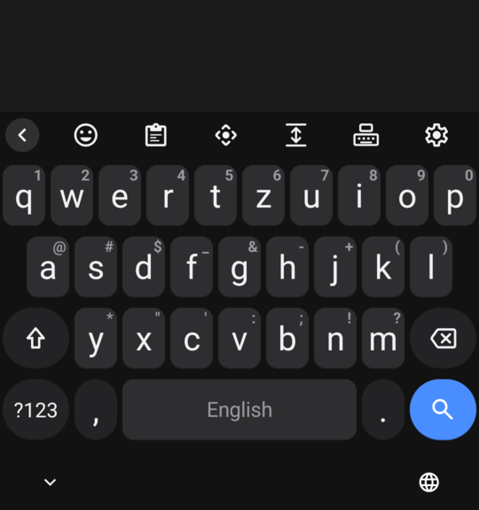
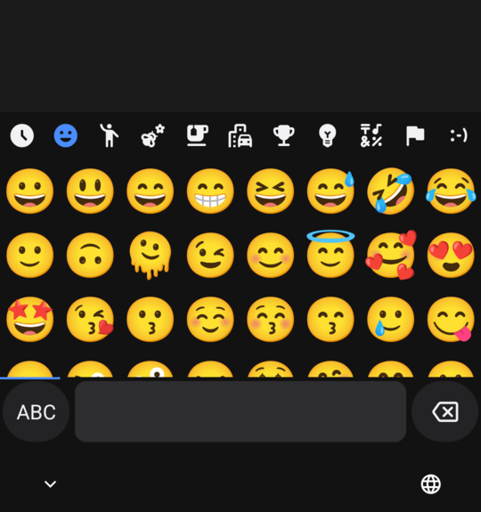
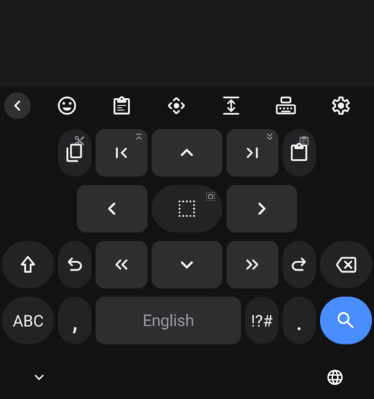
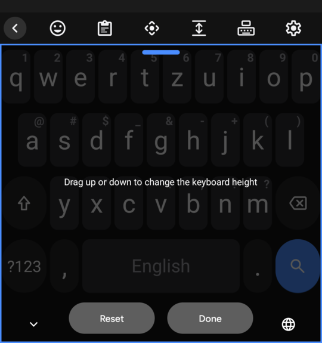
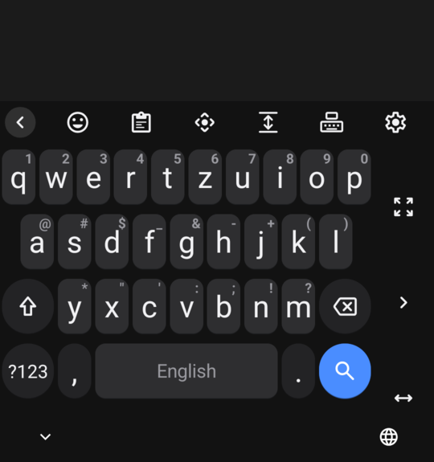
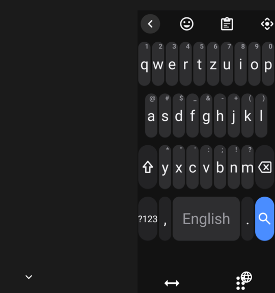

# One Keyboard

A Samsung-Keyboard-style keyboard for AOSP and LineageOS phones. It is a fork of
[HeliBoard](https://github.com/HeliBorg/HeliBoard) and keeps HeliBoard's dictionaries, suggestions,
clipboard history and emoji. On top of that it adds the layout, look and toolbar of the One UI keyboard,
and uses **QWERTZ** by default.

It works fully offline and does not request the internet permission.

> Not affiliated with Samsung or with the HeliBoard project. "Samsung" and "One UI" are only mentioned to
> describe the style this keyboard copies.

| Keyboard | Emoji | Text editing |
|---|---|---|
|  |  |  |

| Keyboard size | One-handed | Floating |
|---|---|---|
|  |  |  |

## What's different from HeliBoard

- **QWERTZ by default** for English and Slovenian. German keeps its `ü ö ä` QWERTZ layout. Other layouts can
  still be picked in *Settings → Languages & Layouts*.
- **One UI light and dark themes.** White keys on light grey, or grey keys on near-black, with a blue accent
  and rounded keys. The theme follows the system's dark mode.
- **Samsung-style toolbar.** It shows when the keyboard opens and switches to word suggestions once you
  start typing. The default buttons are:
  Emoji · Clipboard · **Mode** · Text editing · **Keyboard size** · Voice · Settings.
  Tap `<` for the full list of tools. You can reorder them in *Settings → Toolbar*.
- **Mode button (new).** Each tap moves to the next mode: standard → one-handed → floating → standard.
- **Keyboard size editor (new).** An overlay on the keyboard: drag up or down to change the height, then tap
  **Done** or **Reset**.
- **Clipboard keeps items.** Items are not deleted after a time limit. Pinned items always stay.
- **Samsung-like defaults:** key vibration on, and an automatic space after punctuation.

These HeliBoard features were already Samsung-like and are unchanged:
- Long-press `,` for clipboard, emoji, one-handed, floating and settings.
- Long-press `.` for punctuation.
- Hint characters on the keys.
- Touch and slide on the space bar to move the cursor.
- The text-editing panel.
- Clipboard pinning.
- Split keyboard.

## Install

Download the APK from [Releases](../../releases), install it, then turn it on in
*Settings → System → Keyboard → On-screen keyboard*.

From a computer with adb:

```bash
adb install OneKeyboard_1.0-release.apk
adb shell ime enable dev.david.onekeyboard/helium314.keyboard.latin.LatinIME
adb shell ime set dev.david.onekeyboard/helium314.keyboard.latin.LatinIME
```

The package name is `dev.david.onekeyboard`, so it installs next to HeliBoard and the AOSP keyboard.

## Swipe (glide) typing

Swipe typing needs Google's proprietary `libjni_latinimegoogle.so`. That library is **not** in this
repository and **not** in the release APK. There are two ways to add it:

1. **At runtime, the HeliBoard way:** go to *Settings → Advanced → Load gesture typing library*. See
   [HeliBoard's wiki](https://github.com/HeliBorg/HeliBoard/wiki/FAQ) for where to get the library.
2. **At build time, from your own phone:** if your ROM ships GApps (for example MindTheGapps), copy the
   library and the `libc++.so` it depends on into `app/src/main/jniLibs/` before building:

   ```bash
   mkdir -p app/src/main/jniLibs/arm64-v8a
   adb pull /product/lib64/libjni_latinimegoogle.so app/src/main/jniLibs/arm64-v8a/
   adb pull /system/lib64/libc++.so app/src/main/jniLibs/arm64-v8a/
   ```

   `app/src/main/jniLibs/` is git-ignored so the libraries can't be committed by accident.

## Build

You need JDK 17+ (Android Studio's bundled JBR works), the Android SDK (compileSdk 37) and
NDK `28.0.13004108`.

```bash
JAVA_HOME=/opt/android-studio/jbr ANDROID_HOME=~/Android/Sdk ./gradlew :app:assembleRelease
```

The APK is written to `app/build/outputs/apk/release/`. Builds are arm64-v8a only; change `abiFilters`
in `app/build.gradle.kts` for other architectures. The release build is signed with the debug key, so use
your own signing config if you plan to distribute it.

## Where the changes are

| Change | File |
|---|---|
| QWERTZ defaults | `app/src/main/res/xml/method.xml` |
| One UI themes | `app/src/main/java/helium314/keyboard/keyboard/KeyboardTheme.kt` |
| Default toolbar, MODE and RESIZE keys | `app/src/main/java/helium314/keyboard/latin/utils/ToolbarUtils.kt` |
| Mode cycling | `app/src/main/java/helium314/keyboard/keyboard/internal/KeyboardState.kt` |
| Keyboard size overlay | `app/src/main/java/helium314/keyboard/latin/KeyboardWrapperView.kt` |
| Other defaults | `app/src/main/java/helium314/keyboard/latin/settings/Defaults.kt` |

## Credits and license

- [HeliBoard](https://github.com/HeliBorg/HeliBoard) by Helium314 and contributors. HeliBoard's original
  README is in [README-HeliBoard.md](README-HeliBoard.md). HeliBoard is based on OpenBoard and the AOSP
  LatinIME.
- This fork was made with the help of Claude (Anthropic). Please report problems with it here, not to
  HeliBoard.

The project is licensed under **GPL-3.0-only**, like HeliBoard; see [LICENSE](LICENSE). Some parts are
Apache-2.0 or CC-BY-SA-4.0, as noted in [LICENSE-Apache-2.0](LICENSE-Apache-2.0) and
[LICENSE-CC-BY-SA-4.0](LICENSE-CC-BY-SA-4.0).
